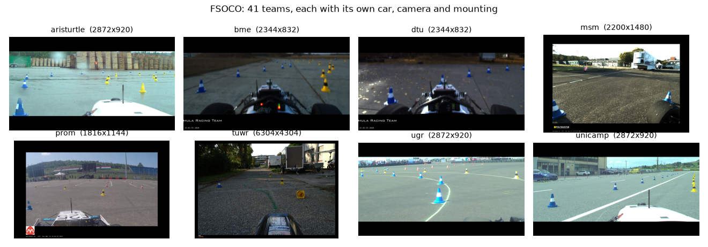
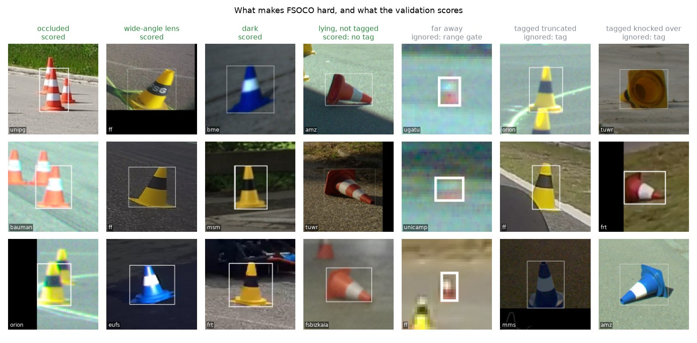
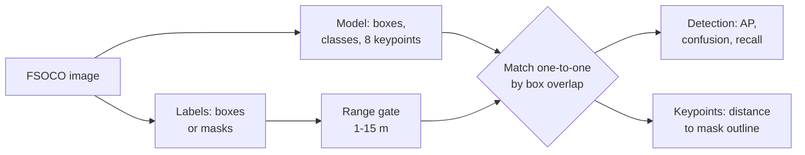
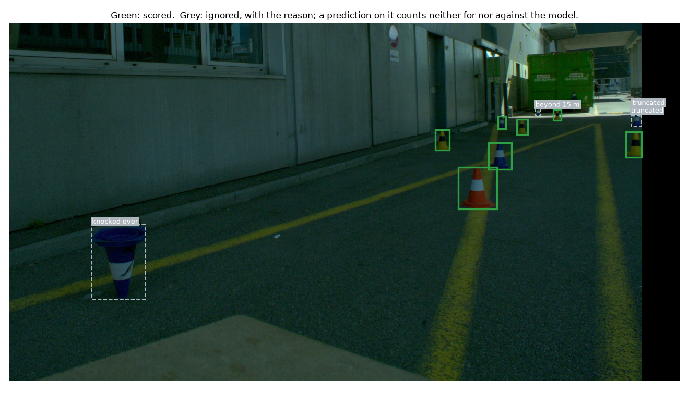
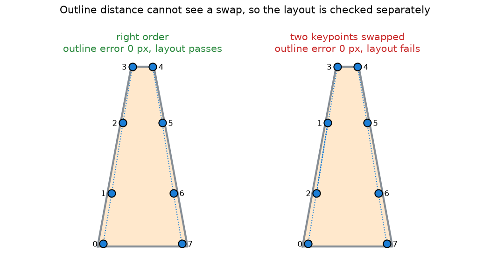
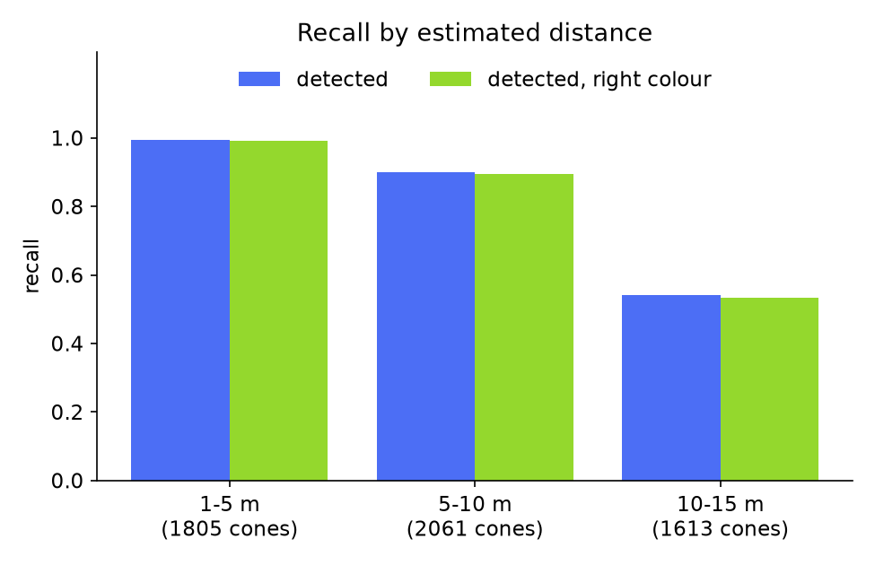
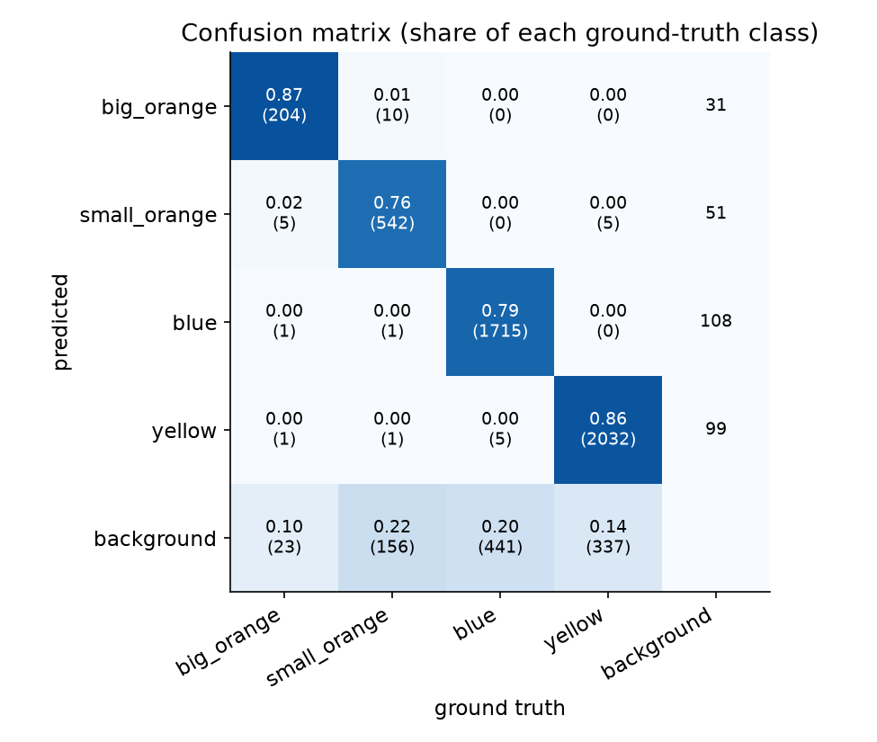
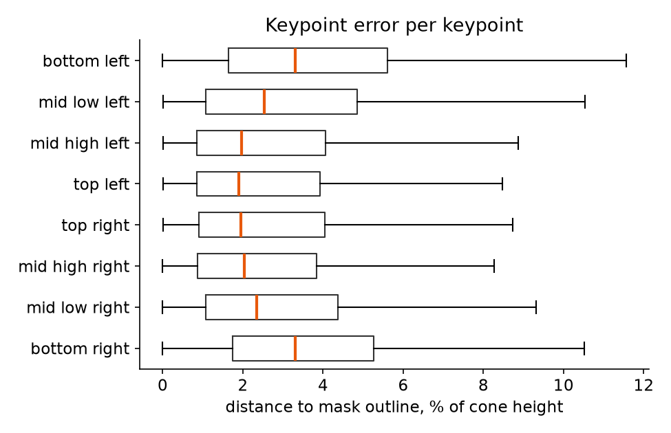
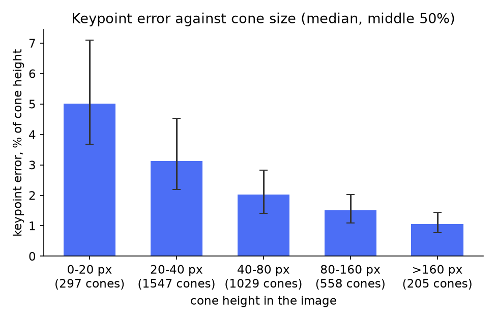

# Cone Pose Validation

Validate a cone detector with keypoints (YOLOv8-pose) on the public [FSOCO dataset](https://fsoco.github.io/fsoco-dataset/): how well it finds cones, and how accurately its keypoints sit on them, without labelling a single keypoint.


## Why

A Formula Student driverless car reads the track from coloured cones, and with a single camera it estimates where each cone stands from keypoints on the cone's outline. Validating such a model normally means hand-labelling keypoints on a validation set.

This workflow skips that. FSOCO, the community cone dataset, has no keypoint labels, but it has pixel masks, and a mask's outline is exactly where the keypoints should sit. Reusing it saves the manual labelling. And because FSOCO pools images from more than 40 teams, cars and cameras, the same run also shows how the detector holds up across camera setups, image quality and mounting positions.



The workflow uses both FSOCO sets:

| Part | FSOCO data | Measures |
|---|---|---|
| Detection | 11,572 images with boxes | AP per class over IoU 0.50 to 0.95, confusion matrix with a background class, recall by distance |
| Keypoints | 1,517 images with masks | distance of every predicted keypoint to the cone outline traced from the mask, and a check that the keypoints keep their layout |

## What is in the data



Occluded, dark and lens-distorted cones are scored: they are the realistic hard cases. Cones beyond the range gate, and cones FSOCO tags as truncated or knocked over, are ignored, because their box height says nothing reliable about distance. FSOCO does not tag every fallen cone, so a few lying cones stay in the scored set.

## How it works



- **Matching.** COCO-style: highest score first, each prediction takes the free ground-truth cone it overlaps most.
- **Range gate.** Distance comes from the cone's known height: `distance = cone height x focal length / box height`. Cones outside 1 to 15 m, unknown cones, and cones tagged truncated or knocked over are ignored: a prediction on them counts neither for nor against the model.



- **Keypoint error.** The mask outline is where the cone's edge really is. Every keypoint the model predicts should lie on it, so the distance to the outline, in pixels and as a share of cone height, measures accuracy without hand labels (figure at the top).
- **Layout check.** A keypoint can sit on the outline in the wrong place, so the keypoints' order is checked as well:



## Example results

What the scripts produce, run on a sample spread over every team: every 25th image of the box set (457 images, 5,479 cones inside the gate) and every 4th of the mask set (371 images, 4,228 cones), with the model's own fine-tuning images left out. The model is the team's YOLOv8s-pose cone detector.

<table>
  <tr>
    <td width="50%"></td>
    <td width="50%"></td>
  </tr>
  <tr>
    <td></td>
    <td></td>
  </tr>
</table>

What they show for this model:

- **Misses, not mix-ups.** Of 4,522 cones found, 29 got the wrong colour; the errors are cones not found at all.
- **Range is the main limit.** Recall is 99% below 5 m, 90% at 5 to 10 m and 54% at 10 to 15 m.
- **Boxes are good, not tight.** mAP@50 is 0.88 but mAP@50-95 is 0.60: AP falls steeply above IoU 0.8, where a few pixels decide on a small cone (`ap_vs_iou.png`).
- **Keypoints sit within 2 to 3% of cone height** (median), about 1 px. Error grows from 1% on large cones to 5% on cones under 20 px, and the two bottom keypoints carry the base-plate offset of the masks.

## Quick start

```bash
pip install -r requirements.txt
```

Download FSOCO from its [website](https://fsoco.github.io/fsoco-dataset/) (the bounding-box and the segmentation set) and point the scripts at the folders that hold the team folders.

```bash
python evaluate_detection.py --model your_cone_model.pt --dataset data/fsoco_bounding_boxes_train
python evaluate_keypoints.py --model your_cone_model.pt --dataset data/fsoco_segmentation_train
python visualize.py --model your_cone_model.pt --image data/fsoco_segmentation_train/<team>/img/<image>
```

Results go to `results/`: a JSON summary plus `confusion_matrix.png`, `ap_vs_iou.png`, `recall_by_distance.png`, `keypoint_errors.png` and `keypoint_error_by_size.png`. `--limit 20` runs a quick check, and `--exclude list.txt` leaves out images the model was trained on. `python make_figures.py --dataset ...` rebuilds the figures in this README.

## Using your own model

Edit `config.yaml`: which model class is which FSOCO class, each cone's height, the order of your keypoints, and the range gate. The scripts print the class mapping they use and stop if the model's classes or keypoints do not match the config.

## Limits

- FSOCO has no camera intrinsics, so the range gate assumes one camera (80 degree vertical field of view) for every image. For teams with a narrower lens or cropped frames the estimate can be off several times, so treat the gate as a coarse near/far split, and set `vertical_fov_deg` for your own camera.
- Outline distance cannot see a keypoint that slides along the outline to the wrong place. The layout check (left of right, each side ordered bottom to top) catches swaps and mirrored keypoints, not small slides.
- FSOCO masks include the cone's base plate. A keypoint defined on the cone body above the plate shows that gap as error.

## Background

I built this as Perception System Engineer at Schanzer Racing Electric, the Formula Student team of TH Ingolstadt, to validate the team's cone detector. The detector runs on the car on an NVIDIA Jetson; the model is not part of this repository.

## Credits

- [FSOCO](https://fsoco.github.io/fsoco-dataset/), the Formula Student Objects in Context dataset: M. Vödisch et al., "FSOCO: The Formula Student Objects in Context Dataset", SAE International Journal of Connected and Automated Vehicles, 2022. Not redistributed here; the figures show FSOCO images.
- [Ultralytics YOLOv8](https://github.com/ultralytics/ultralytics).
- Code: MIT.
