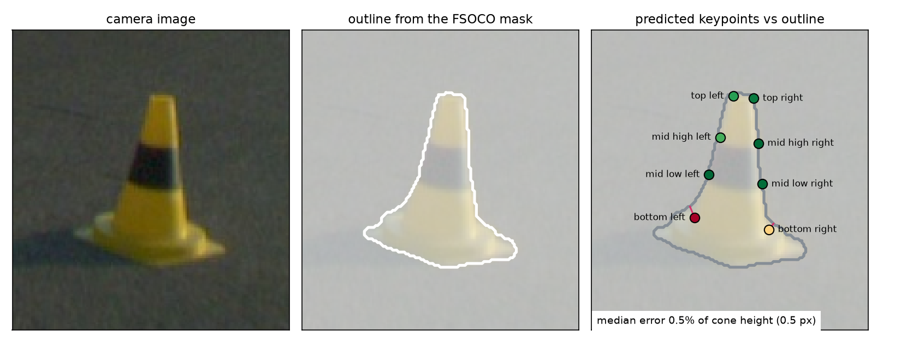
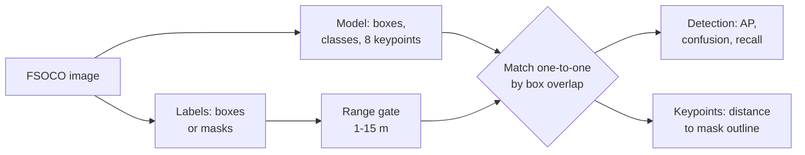

# Cone Pose Validation

Validate a cone detector with keypoints (YOLOv8-pose) on the public [FSOCO dataset](https://fsoco.github.io/fsoco-dataset/): how well it finds cones, and how accurately its keypoints sit on them, without labelling a single keypoint.



## Why

A Formula Student driverless car reads the track from coloured cones, and with a single camera it estimates where each cone stands from keypoints on the cone's outline. A model trained on one team's car has to work on any camera, mounting angle and light. FSOCO pools images from more than 40 teams, so it is a hard test of robustness and generalisation.

FSOCO has cone boxes and pixel masks, but no keypoints. This workflow uses both:

| Part | FSOCO data | Measures |
|---|---|---|
| Detection | 11,572 images with boxes | AP per class over IoU 0.50 to 0.95, confusion matrix with a background class, recall by distance |
| Keypoints | 1,517 images with masks | distance of every predicted keypoint to the cone outline traced from the mask, and a check that the keypoints keep their layout |

## How it works



- **Matching.** COCO-style: highest score first, each prediction takes the free ground-truth cone it overlaps most.
- **Range gate.** Distance comes from the cone's known height: `distance = cone height x focal length / box height`. Cones outside 1 to 15 m, unknown cones, and cones tagged truncated or knocked over are ignored: a prediction on them counts neither for nor against the model.
- **Keypoint error.** The mask outline is where the cone's edge really is. Every keypoint the model predicts should lie on it, so the distance to the outline, in pixels and as a share of cone height, measures accuracy without hand labels.

## Quick start

```bash
pip install -r requirements.txt
```

Download FSOCO from its [website](https://fsoco.github.io/fsoco-dataset/) (the bounding-box and the segmentation set) and point the scripts at the folders that hold the team folders.

```bash
python evaluate_detection.py --model your_cone_model.pt --dataset data/fsoco_bounding_boxes_train
python evaluate_keypoints.py --model your_cone_model.pt --dataset data/fsoco_segmentation_train
python visualize.py --model your_cone_model.pt --image data/fsoco_segmentation_train/<team>/img/<image>
```

Results go to `results/`: a JSON summary plus `confusion_matrix.png`, `ap_vs_iou.png`, `recall_by_distance.png` and `keypoint_errors.png`. `--limit 20` runs a quick check, and `--exclude list.txt` leaves out images the model was trained on.

## Using your own model

Edit `config.yaml`: which model class is which FSOCO class, each cone's height, the order of your keypoints, and the range gate. The scripts print the class mapping they use and stop if the model's classes or keypoints do not match the config.

## Limits

- FSOCO has no camera intrinsics, so the range gate assumes one camera (80 degree vertical field of view) for every image. Distances are approximate.
- Outline distance cannot see a keypoint that slides along the outline to the wrong place. The layout check (left of right, each side ordered bottom to top) catches swaps and mirrored keypoints, not small slides.
- FSOCO masks include the cone's base plate. A keypoint defined on the cone body above the plate shows that gap as error.

## Background

I built this as Perception System Engineer at Schanzer Racing Electric, the Formula Student team of TH Ingolstadt, to validate the team's cone detector. The detector runs on the car on an NVIDIA Jetson; the model is not part of this repository.

## Credits

- [FSOCO](https://fsoco.github.io/fsoco-dataset/), the Formula Student Objects in Context dataset: M. Vödisch et al., "FSOCO: The Formula Student Objects in Context Dataset", SAE International Journal of Connected and Automated Vehicles, 2022. Not redistributed here; the figure above shows one FSOCO image.
- [Ultralytics YOLOv8](https://github.com/ultralytics/ultralytics).
- Code: MIT.
